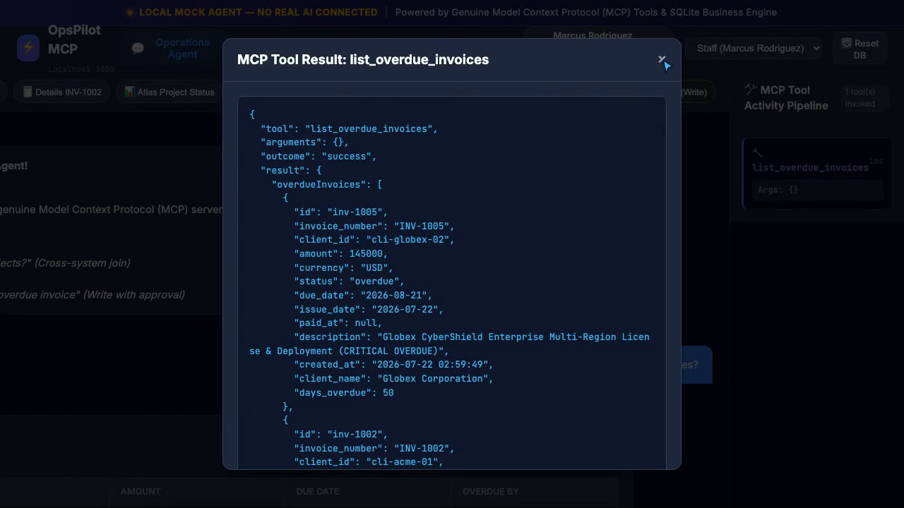
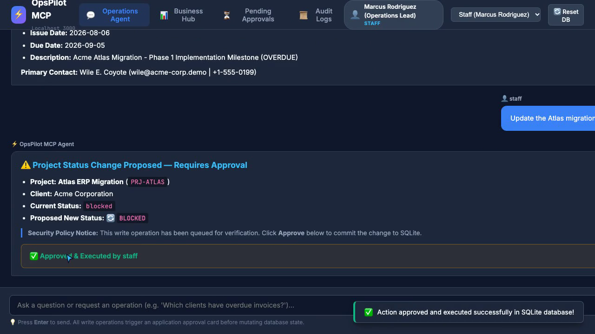
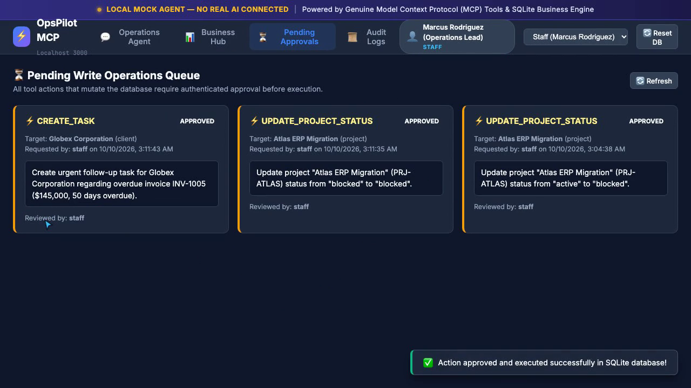
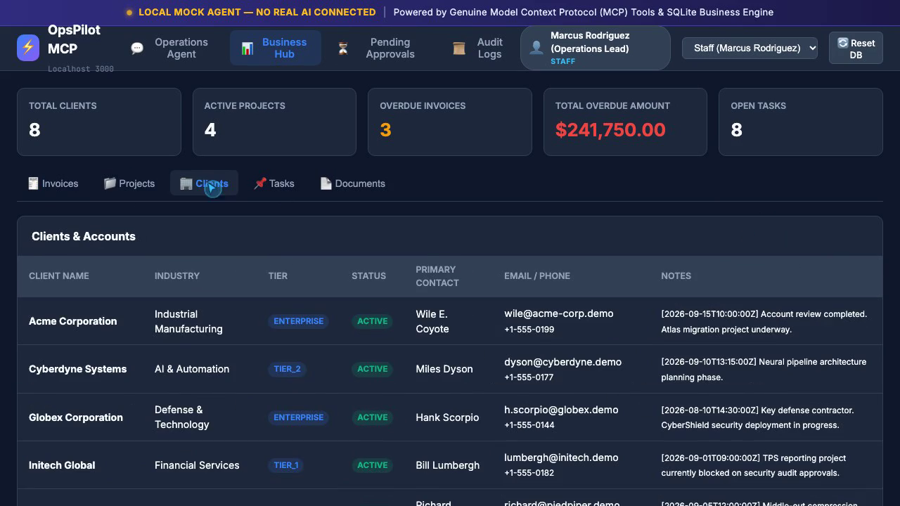
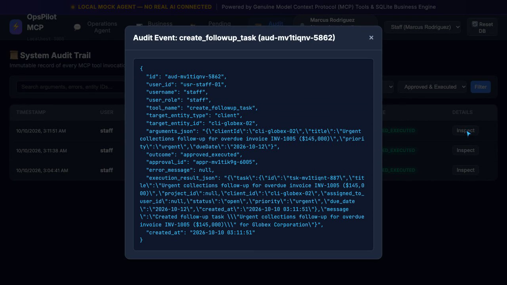

# Local MCP Business Operations Agent (OpsPilot MCP)

A complete, functional, portfolio-quality **Business Operations Agent powered by a genuine Model Context Protocol (MCP) server and a local deterministic mock agent**.

This application runs **100% locally** on your computer without Claude, OpenAI, LLM API keys, paid services, or external integrations.

```
+-----------------------------------------------------------------------------------+
|                        LOCAL MOCK AGENT — NO REAL AI CONNECTED                     |
+-----------------------------------------------------------------------------------+
|                                                                                   |
|  [ Web UI / Browser Console ] <---> [ Express 5 API Server + Session Auth ]       |
|                                                     |                             |
|                                                     v                             |
|                                       [ Deterministic Intent Router ]             |
|                                                     |                             |
|                                                     v                             |
|                                       [ Official MCP Server Engine ]              |
|                                         - CRM Tools                               |
|                                         - Accounting Tools                        |
|                                         - Project Management Tools                |
|                                         - Document Repository Tools               |
|                                         - Write Mutation Tools                    |
|                                                     |                             |
|                                                     v                             |
|                                   [ Secure Approval Workflow Manager ]            |
|                                      - Role Authorization (RBAC)                  |
|                                      - Immutable Audit Trail                      |
|                                      - Previews & Expiration TTL                  |
|                                                     |                             |
|                                                     v                             |
|                                         [ Local SQLite Database ]                 |
|                                                                                   |
+-----------------------------------------------------------------------------------+
```

---

## 📸 Application Preview & Interface Tour

| Operations Agent & Live MCP Drawer | Multi-Tool Cross-System Analysis |
|:---:|:---:|
|  |  |

| Secure Approval Workflow Card | Business Hub Data Explorer |
|:---:|:---:|
|  |  |

| Tamper-Evident System Audit Trail |
|:---:|
|  |

---

## 🌟 Key Features

1. **Genuine Model Context Protocol (MCP) SDK Server**:
   - Implements `@modelcontextprotocol/sdk` with standard tools across CRM, Accounting, Project Management, and Documents.
   - Fully typed and validated with **Zod** schemas.
   - Usable standalone via stdio transport and compatible with the **MCP Inspector**.

2. **Deterministic Local Mock Agent**:
   - Zero LLM API keys or external dependencies.
   - Robust pattern matching and entity resolution for complex multi-intent and cross-system queries.
   - Clearly labeled: **LOCAL MOCK AGENT — NO REAL AI CONNECTED**.

3. **Multi-Tool Cross-System Joins**:
   - Resolves questions spanning multiple domains (e.g. *"Which clients have overdue invoices and active projects?"*) by chaining real MCP tool invocations and synthesizing data on the fly.

4. **Secure Write Approval Workflows**:
   - Enforces application-level approval cards for all database mutations (`create_followup_task`, `add_client_note`, `update_project_status`).
   - Generates exact parameter previews, enforces TTL expiration, blocks duplicate executions (idempotency), and respects user permissions.

5. **Role-Based Access Control & Authentication**:
   - Seeded accounts for **Administrator**, **Staff**, and **Read-Only** users.
   - Password hashing with `bcryptjs`, cookie-based sessions, and CSRF token protection.
   - Read-only users cannot propose or approve write mutations.

6. **Comprehensive Audit Trail**:
   - Logs every tool invocation, read query, proposed write action, approval execution, rejection, and error to SQLite.
   - Sensitive keys are automatically redacted. Filterable and searchable via the UI.

7. **Clean Modern Dashboard UI**:
   - Dark-mode responsive operations dashboard.
   - Live chat console with quick-prompt chips.
   - Real-time MCP tool activity inspector drawer.
   - Business data hub (Invoices, Projects, Clients, Tasks, Documents).
   - Dedicated pending approvals queue and audit log viewer.

---

## 👥 Demo User Accounts

| Username | Password | Role | Permissions |
|:---|:---|:---|:---|
| `admin` | `admin123` | **Administrator** | Full access: queries, proposals, approvals, audit log inspection, deterministic DB reset |
| `staff` | `staff123` | **Staff** | Operational access: queries, proposing write mutations, approving operations |
| `readonly` | `readonly123` | **Read-Only** | Compliance access: query authorized business data only, write/approval actions blocked |

---

## 🚀 Quickstart Guide

### 1. Install Dependencies
```bash
npm install
```

### 2. Reset / Seed SQLite Database
Populate the database with interconnected sample data (clients, overdue invoices, projects, tasks, documents):
```bash
npm run db:reset
```

### 3. Start the Web Application
```bash
npm run dev
```
Open **[http://localhost:3000](http://localhost:3000)** in your browser.

---

## 🛠️ MCP Tools & Schemas

The MCP server registers the following typed tools:

### CRM Tools
- `search_clients(query?, tier?, status?)`: Search clients by keyword, tier (`enterprise`, `tier_1`, etc.), or status (`active`, `inactive`, `prospect`).
- `get_client_details(clientId)`: Retrieve client profile including active projects, invoices, open tasks, and documents.

### Accounting Tools
- `list_invoices(clientId?, status?)`: List invoices filtered by client or payment status (`paid`, `unpaid`, `overdue`, `draft`).
- `list_overdue_invoices()`: Ranked list of overdue invoices with days overdue and client names.
- `get_invoice_details(invoiceId)`: Complete details for a specific invoice (e.g. `INV-1002`).

### Project Management Tools
- `list_projects(clientId?, status?)`: List enterprise projects filtered by status (`active`, `blocked`, `on_hold`, `planning`, `completed`).
- `get_project_status(projectId)`: Retrieve operational status, budget, timelines, and open tasks for a project (e.g. `PRJ-ATLAS`).
- `list_open_tasks(clientId?, projectId?)`: List open and in-progress operational tasks.

### Document Tools
- `search_documents(query?, docType?, clientId?)`: Search documents (contracts, proposals, specs, reports).
- `get_document_metadata(documentId)`: Retrieve document summary and file path.

### Write Mutation Tools (Require Approval)
- `create_followup_task(clientId, title, priority?, dueDate?, projectId?)`: Create a new follow-up task.
- `add_client_note(clientId, note)`: Append timestamped note to client record.
- `update_project_status(projectId, status)`: Change project lifecycle status.

---

## 🔍 Testing the MCP Server Standalone with MCP Inspector

The MCP server can run independently via standard I/O transport.

### 1. Build TypeScript code
```bash
npm run build
```

### 2. Launch with the official MCP Inspector
```bash
npx @modelcontextprotocol/inspector node dist/mcp/standalone.js
```
or run with `tsx`:
```bash
npx @modelcontextprotocol/inspector npm run mcp:server
```

You will be able to inspect schemas, list tools, and invoke any tool directly through the MCP Inspector UI.

---

## 💬 Supported Mock Agent Prompts

Try entering any of the following requests in the chat console or clicking the quick-prompt chips:

- **Overdue Invoices:** `"Which clients have overdue invoices?"`
- **Cross-System Analysis:** `"Which clients have overdue invoices and active projects?"`
- **Invoice Inspection:** `"Show me the details of invoice INV-1002"`
- **Project Progress:** `"Show the current status of the Atlas migration project"`
- **Client Open Tasks:** `"List all open tasks for Acme Corp"`
- **Create Follow-up (Write):** `"Create a follow-up task for the client with the most overdue invoice"`
- **Update Status (Write):** `"Update the Atlas migration project to blocked"`
- **Append Note (Write):** `"Add a note to Acme Corp: Payment promised by next Tuesday"`

---

## 🧪 Automated Testing

The repository includes a comprehensive unit and integration test suite:

```bash
npm test
```

### Test Coverage Highlights:
- **`tests/mcp-tools.test.ts`**: Zod argument validation, invoice & client lookups, project status, document searching, and graceful missing record handling.
- **`tests/approval-workflow.test.ts`**: Write action proposals, preview generation, expiration TTL, idempotency (preventing double approvals), rejections, and read-only user restrictions.
- **`tests/mock-agent.test.ts`**: Intent routing patterns, cross-system joins, natural language synthesis, and help fallbacks.
- **`tests/api.test.ts`**: HTTP API, authentication, cookie sessions, CSRF protection, and role-based permissions.

---

## 📁 Project Structure

```
local_mcp_business_op/
├── src/
│   ├── types/               # Domain interfaces & TypeScript types
│   ├── db/                  # SQLite schema, repository queries & deterministic seed
│   ├── mcp/                 # Official MCP SDK server & tool definitions
│   ├── agent/               # Deterministic intent router & mock agent orchestrator
│   ├── approval/            # Secure approval workflow engine & TTL manager
│   ├── audit/               # Structured audit logger with sensitive field redaction
│   ├── auth/                # Session manager, bcrypt hashing, and CSRF middleware
│   ├── api/                 # Express API routes for chat, data, approvals & audit
│   └── server.ts            # Local web server entrypoint
├── public/                  # Lightweight vanilla frontend
│   ├── index.html           # Single-page operations dashboard layout
│   ├── style.css            # Dark mode operations UI styling
│   └── app.js               # Reactive UI controller & tool visualizer
├── tests/                   # Vitest automated test suite
├── package.json
├── tsconfig.json
├── .env.example
└── README.md
```

---

## 🛡️ Security & Compliance Notes

- **Zero External Telemetry**: All data remains in your local SQLite database (`./data/business_ops.sqlite`).
- **No LLM Hallucinations**: Responses are built purely from real SQLite records retrieved via typed MCP tool calls.
- **Sanitized Logging**: All audit logs redact sensitive fields (tokens, passwords, session secrets).
- **CSRF Protected**: All state-changing POST/PUT endpoints require a valid session CSRF token.
